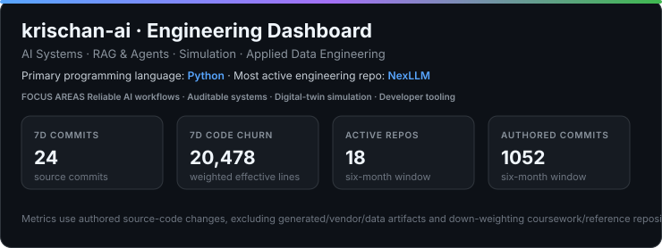
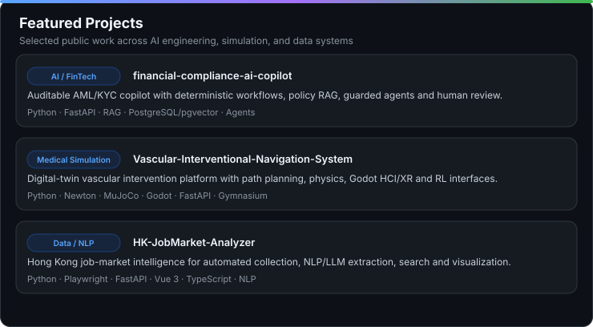
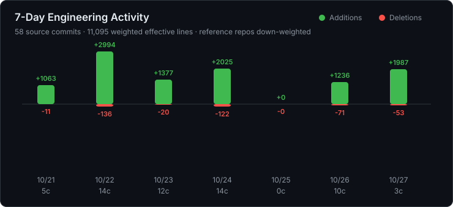
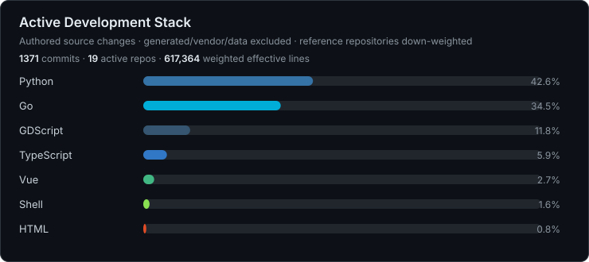

# krischan-ai

AI Systems · RAG & Agents · Simulation · Applied Data Engineering

## Featured Projects

- [Financial Compliance & Transaction Risk AI Copilot](https://github.com/krischan-ai/financial-compliance-ai-copilot) — auditable AML/KYC review workflows, policy RAG, guarded agent assistance, human review, traceability and regression-tested backend engineering.
- [Vascular Interventional Navigation System](https://github.com/krischan-ai/Vascular-Interventional-Navigation-System) — digital-twin vascular intervention research platform spanning path planning, Newton/MuJoCo physics, Godot HCI/XR, FastAPI and reinforcement-learning interfaces.
- [HK Job Market Analyzer](https://github.com/krischan-ai/HK-JobMarket-Analyzer) — automated Hong Kong job-market collection and intelligence with data cleaning, NLP/LLM extraction, knowledge-base search, FastAPI and Vue 3 visualization.

## Recent Engineering Activity

## Active Development Stack

## Active Projects

## Metrics reliability

`generate-languages.js` retries transient socket/time-out failures (including response-body
reads), HTTP 500/502/503/504, and explicit rate limits up to four total attempts.
Each attempt has a 30-second timeout; retries use 1/2/4-second exponential backoff
plus jitter. `Retry-After` and primary rate-limit reset times are honored within a
30-second wait budget; longer waits fail with the original API diagnostic.

`LANGUAGE_API_CONCURRENCY` defaults to `3` (allowed range: `1`–`5`). A global request
limiter also covers nested repository/branch pools. Ordinary authentication,
permission and validation errors are not retried. Existing public-repository fallback
for `/user/repos` permission errors is retained with an explicit warning; exhausted
rate limits never trigger that fallback. Unavailable branches (404) and empty
repositories (409) retain their existing warnings; other collection failures stop
instead of publishing incomplete language statistics. The previous SVG is retained
on failure. Statistics weights, exclusions, deduplication and rendering are unchanged.

Run `node --test test/*.test.js` (Node.js 20 or newer) to verify retries, API errors,
concurrency and a full five-generator fixture run with an actual socket disconnect.
The other generators retain their existing request behavior.
